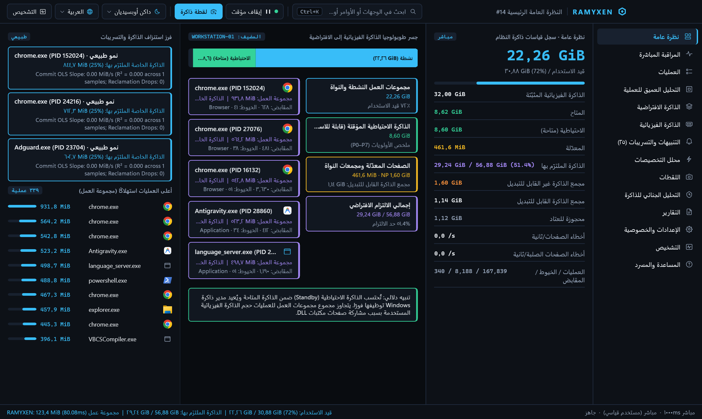
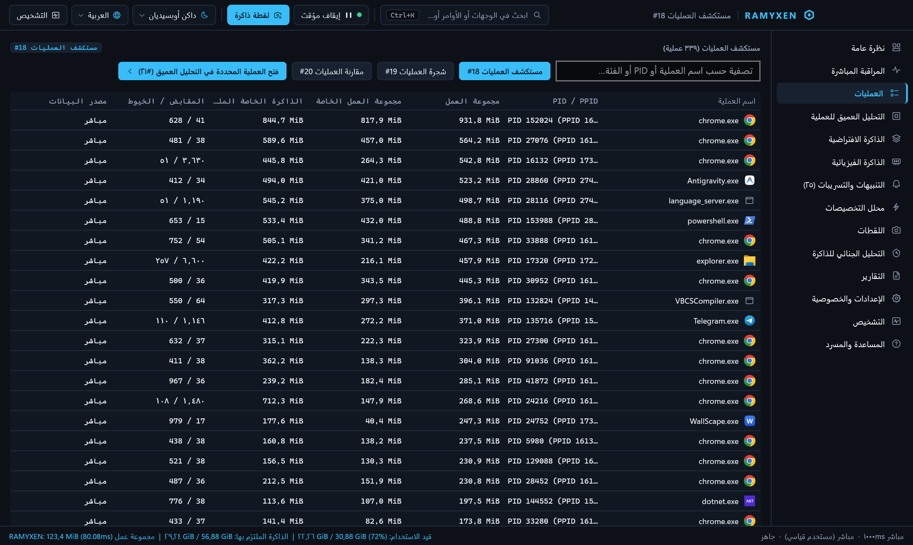
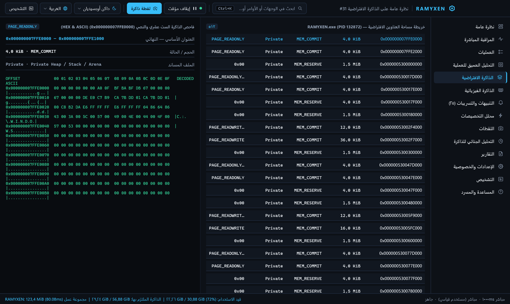
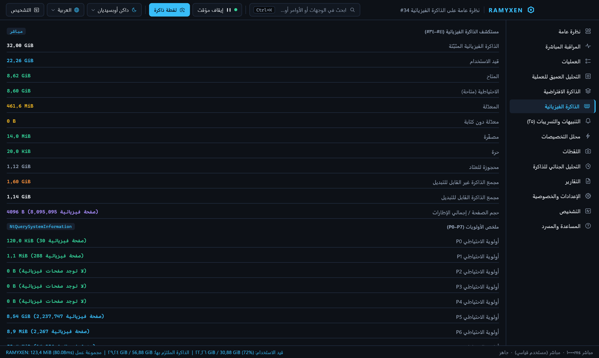
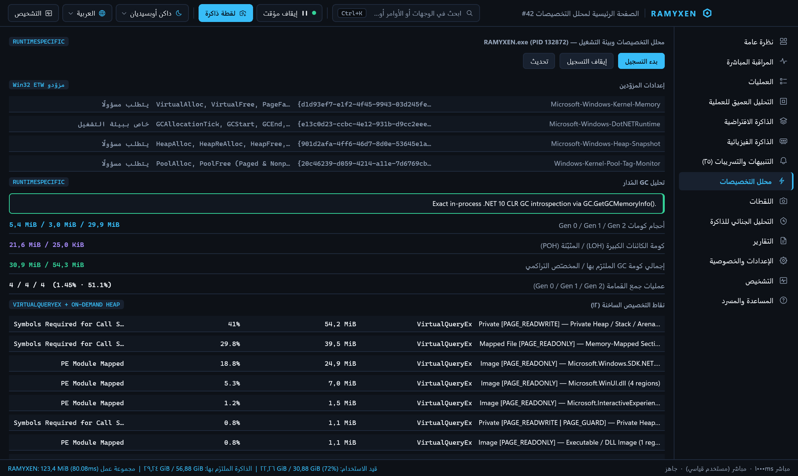
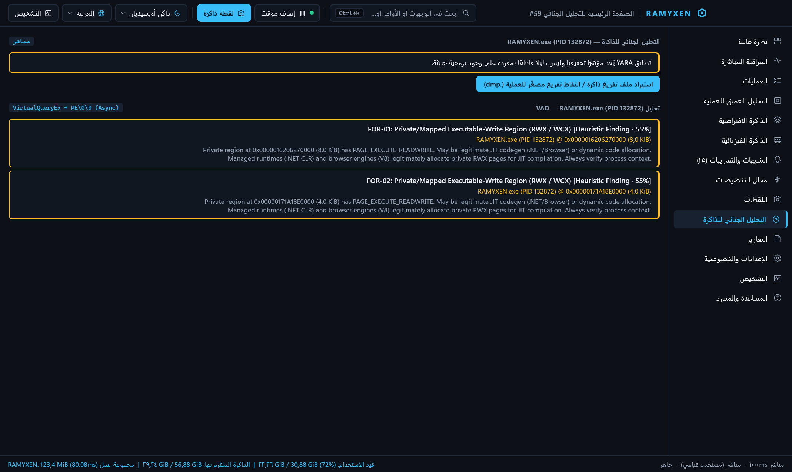
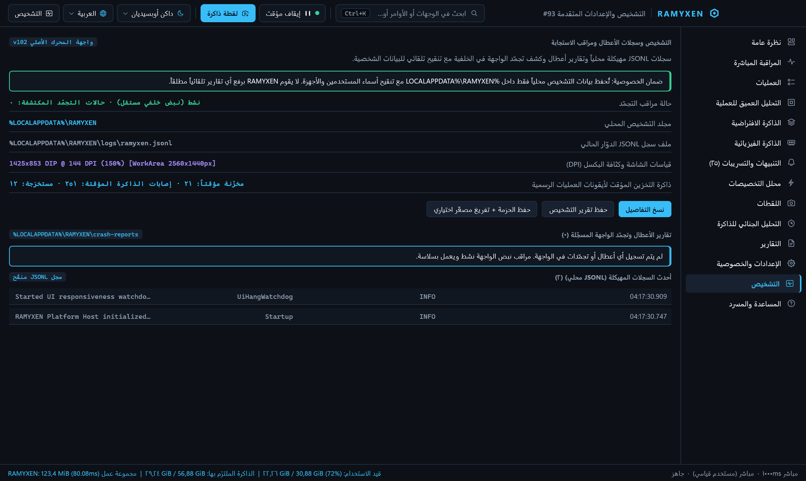
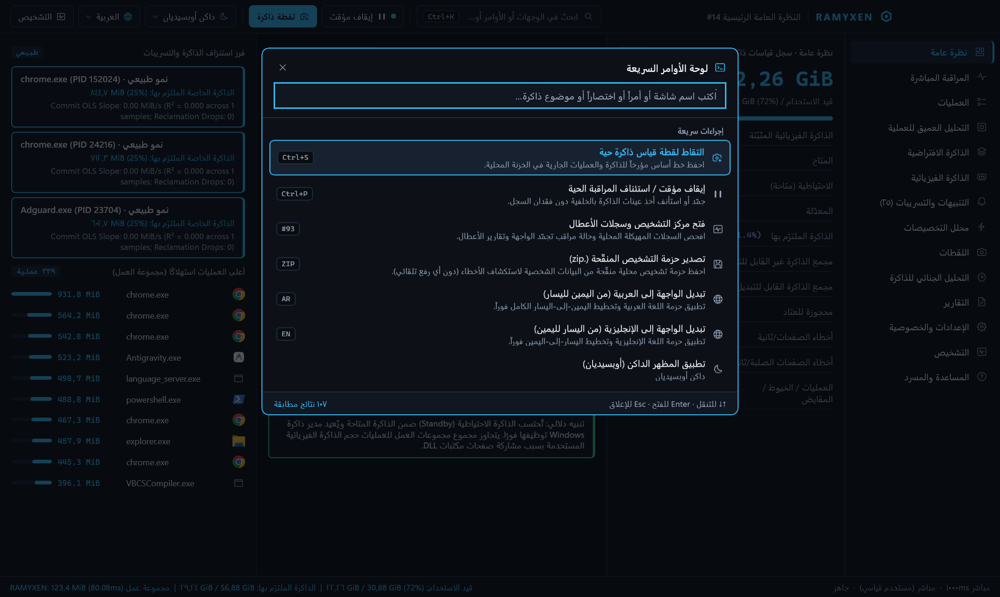

<div align="center" dir="rtl">

**اللغات:** [English](README.md) · **العربية** · [简体中文](README.zh-CN.md) · [日本語](README.ja.md)


# RAMYXEN

### **افهم كل بايت.**
**منصة أصلية لذكاء وفحص وتحليل وتشخيص الذاكرة والتحليل الجنائي على Windows**

**النظام المدعوم:** Windows 11 (`x64`، إصدار 22000+) &nbsp;|&nbsp; **الإصدار:** `v1.1.0` &nbsp;|&nbsp; **البنية التقنية:** WinUI 3 · Windows App SDK 2.7 · .NET 10 LTS · محرك C++20 أصلي (ABI `v102`) + عامل كومة معزول `RAMYXEN.HeapWorker.exe` &nbsp;|&nbsp; **اللغات:** English · العربية (RTL) · 简体中文 · 日本語

[**ملاحظات الإصدار (v1.1.0)**](docs/release/v1.1.0/RELEASE_NOTES.md) &nbsp;·&nbsp; [**المعمارية**](docs/architecture/ARCHITECTURE.md) &nbsp;·&nbsp; [**دليل المستخدم**](docs/user-guide/USER_GUIDE.md) &nbsp;·&nbsp; [**القيود المعروفة**](docs/user-guide/KNOWN_LIMITATIONS.md) &nbsp;·&nbsp; [**المساهمة**](CONTRIBUTING.md)

</div>

---

<div dir="rtl">

## 1. ما هو RAMYXEN؟

تكتفي أدوات المراقبة التقليدية بعرض نسبة مئوية مسطحة لاستهلاك الذاكرة العشوائية، دون توضيح *سبب* نمو الذاكرة، أو ما إذا كان الارتفاع الظاهر مجرد **ذاكرة احتياطية (Standby Cache)** قابلة للاستعادة الفورية أم ضغط التزام حقيقي، أو ما إذا كان نمو العملية يشير إلى تسرّب ذاكرة فعلي أم دورة طبيعية لجامع القمامة.

**RAMYXEN** هو أداة سطح مكتب أصلية تعمل محلياً بالكامل على Windows، توحّد **ست طبقات لذكاء الذاكرة** — **النظام**، **العمليات**، **مساحة العناوين الافتراضية**، **تحليل التخصيصات وبيئة التشغيل**، **قوائم الصفحات الفيزيائية**، و**التحليل الجنائي للذاكرة** — ضمن نظام تصميم **Memory Atlas & Signal Observatory**.

### ما الذي ليس عليه RAMYXEN
- **ليس بديلاً لمدير المهام (Task Manager)** — بل أداة هندسية متخصصة لتحليل وتشخيص الذاكرة بعمق.
- **ليس منظّفاً أو مسرّعاً للذاكرة العشوائية (RAM Cleaner)** — لا يفرّغ مجموعات العمل ولا يدّعي تسريع الذاكرة.
- **ليس برنامج مكافحة فيروسات** — مؤشرات التحليل الجنائي وYARA أدلة استقصائية وليست حكماً مستقلاً بوجود برمجية خبيثة.
- **صفر إرسال سحابي** — تبقى جميع السجلات واللقطات والتقارير والتفريغات الاختيارية محلياً على جهازك فقط.

---

## 2. لقطات شاشة حقيقية للتطبيق (العربية — `ar-SA` RTL)

مُلتقطة مباشرة من تطبيق WinUI 3 المستقل `RAMYXEN.exe` (`1440×860` DIP على Windows 11 x64) مع عزل كامل ثنائي الاتجاه (LRI+LRM) وتوحيد المصطلحات العربية:

### النظرة العامة الرئيسية (`#14`) ومستكشف العمليات (`#18`)



### الذاكرة الافتراضية (`#31`) والذاكرة الفيزيائية (`#34`) ومحلل التخصيصات (`#42`)




### التحليل الجنائي للذاكرة (`#59`) والتشخيص ومراقب الاستجابة (`#93`) ولوحة الأوامر (`Ctrl+K`)




---

## 3. القدرات الرئيسية

1. **ذكاء ذاكرة النظام:** قراءة مباشرة للذاكرة الفيزيائية، الذاكرة الاحتياطية (P0–P7)، الصفحات المعدّلة، الذاكرة الملتزَم بها وحد الالتزام، مجمعات النواة، وسرعة أخطاء الصفحات من `GlobalMemoryStatusEx` و`GetPerformanceInfo` و`NtQuerySystemInformation`.
2. **فحص العمليات والكومة المعزولة:** أيقونات تطبيقات Windows الرسمية (`PrivateExtractIconsW`)، تحليل عميق غير حاجب للواجهة، وعامل كومة خارجي قابل للإنهاء `RAMYXEN.HeapWorker.exe` (سقف `3` ثوانٍ، ABI `v102`، وحماية من إعادة استخدام PID).
3. **استكشاف الذاكرة الافتراضية والفيزيائية:** خريطة مساحة العناوين، أعلام الحماية، فاحص Hex/ASCII الحي، وتصنيفات مصدر بيانات شفافة (`DataSourceProvenance`).
4. **محلل التخصيصات وفرز التسريبات:** انحدار خطي OLS مع معامل $R^2$ دون إنذارات كاذبة، جلسات Win32 ETW حقيقية، وتحليل أجيال `.NET GC` (`Gen 0/1/2` و`LOH` و`POH`).
5. **اللقطات والتحليل الجنائي والتقارير المنقّحة:** لقطات JSON موثّقة ببصمة SHA-256، قراءة ملفات `.dmp` (`MDMP`) دون اتصال، وتصدير CSV وJSON وHTML وPDF 1.4 مع تنقيح موحّد للبيانات الشخصية والمسارات.
6. **التشخيص المحلي ومراقب تجمّد الواجهة:** سجلات JSONL متدحرجة، مراقب استجابة متوافق مع أوضاع الطاقة ومصحّح الأخطاء، وتفريغات اختيارية بموافقة صريحة في `diagnostic-dumps\`.

---

## 4. متطلبات النظام والتثبيت والنسخة المحمولة (Portable)

- **نظام التشغيل:** Windows 11 (`x64`، إصدار 21H2 / 22000 أو أحدث).
- **المثبّت (`RAMYXEN-Setup.exe`):** مثبّت خاص بالمستخدم يدعم الوضع الصامت (`--silent`)، الترقية في نفس المجلد، الحماية من الروابط الرمزية (NTFS Junctions)، وإلغاء التثبيت القابل للاسترداد عند قفل الملفات (يُعيد الرمز الصادق `1603` مع الاحتفاظ بسجل إلغاء التثبيت لإعادة المحاولة بنجاح).
- **النسخة المحمولة المستقلة (`RAMYXEN-Portable-win-x64.zip`):** مدمجة بالكامل مع `<SelfContained>true</SelfContained>` (بيئة `.NET 10.0.15`) و`<WindowsAppSDKSelfContained>true</WindowsAppSDKSelfContained>` (Windows App SDK `2.7.0`) ومكتبة C++ مربوطة بشكل ثابت (`/MT`) دون أي ملفات PDB، بحيث يعمل `RAMYXEN.exe` مباشرة دون مطالبة المستخدم بتثبيت .NET Desktop Runtime أو Visual C++ Redistributable.

---

## 5. الأمان والصلاحيات وحدود النظام

- يعمل التطبيق كمستخدم قياسي للمراقبة الاعتيادية. تقيّد نواة Windows فحص العمليات المحمية (`PPL`) (`ADMIN_REQUIRED`)، وتتطلب جلسات ETW الحية صلاحيات المسؤول أو مجموعة *Performance Log Users* (`ETW_REQUIRED`).
- لا يقوم RAMYXEN أبداً بتثبيت برامج تشغيل نواة غير موقّعة أو إضعاف Secure Boot / HVCI.
- راجع [KNOWN_LIMITATIONS.md](docs/user-guide/KNOWN_LIMITATIONS.md) و[SECURITY.md](SECURITY.md) للتفاصيل الكاملة.

---

## 6. اللغات المدعومة في التطبيق (`4` لغات رسمية)

| الرمز | اللغة | الاتجاه | الاكتمال |
|---|---|---|---|
| `en-US` | English | LTR | `567 / 567` (`100.0%`) |
| `ar-SA` | العربية | RTL (عزل ثنائي الاتجاه LRI+LRM) | `567 / 567` (`100.0%`) |
| `zh-CN` | 简体中文 (الصينية المبسّطة) | LTR | `567 / 567` (`100.0%`) |
| `ja-JP` | 日本語 (اليابانية) | LTR | `567 / 567` (`100.0%`) |

---

## 7. البناء والاختبار والمساهمة (للمطورين)

### المتطلبات
- Windows 11 (`x64`، إصدار 22000+)
- [.NET 10 SDK](https://dotnet.microsoft.com/) (محدّد في `global.json`)
- Visual Studio Build Tools مع حزمة **Desktop development with C++** وWindows 11 SDK (`10.0.22621+`)
- Node.js 20+ للتحقق من حزم اللغة

</div>

```powershell
# بناء كامل قابل لإعادة الإنتاج (C++20 + نسخة محمولة مستقلة + مثبّت + اختبارات)
.\scripts\build-release.ps1 -RunTests

# أو تشغيل حزم التحقق منفردة:
.\src\RAMYXEN.Native\bin\Release\RAMYXEN.Native.Tests.exe
dotnet tests\unit\RAMYXEN.Tests\bin\Release\net10.0-windows10.0.22621.0\win-x64\RAMYXEN.Tests.dll
node .\tools\localization\validate.js
node .\tests\localization\run-localization-tests.js
```

<div dir="rtl">

---

## 8. حالة الترخيص

يخضع الكود المصدري الأصلي والوثائق الأصلية لمشروع RAMYXEN لـ **رخصة Apache الإصدار 2.0 (Apache License 2.0)** — راجع ملف [LICENSE](LICENSE). يُعد النص الإنجليزي في `LICENSE` هو النص القانوني المعتمد.

تبقى مكونات الطرف الثالث (بيئة التشغيل، وحزم SDK، والأيقونات) خاضعة لتراخيصها وإشعاراتها الخاصة كما هو موثّق في [docs/security/THIRD_PARTY_NOTICES.md](docs/security/THIRD_PARTY_NOTICES.md).

</div>
