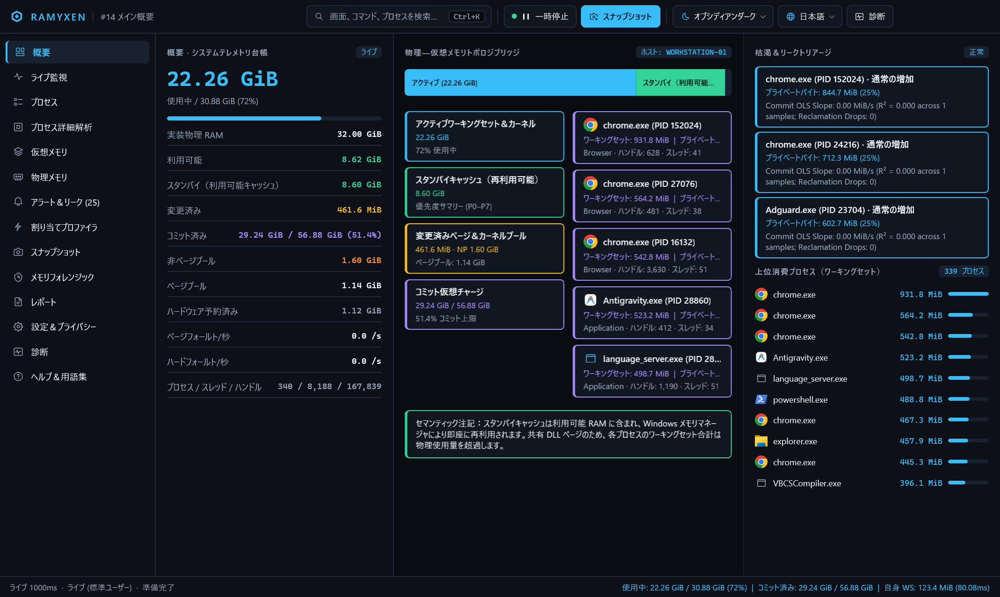
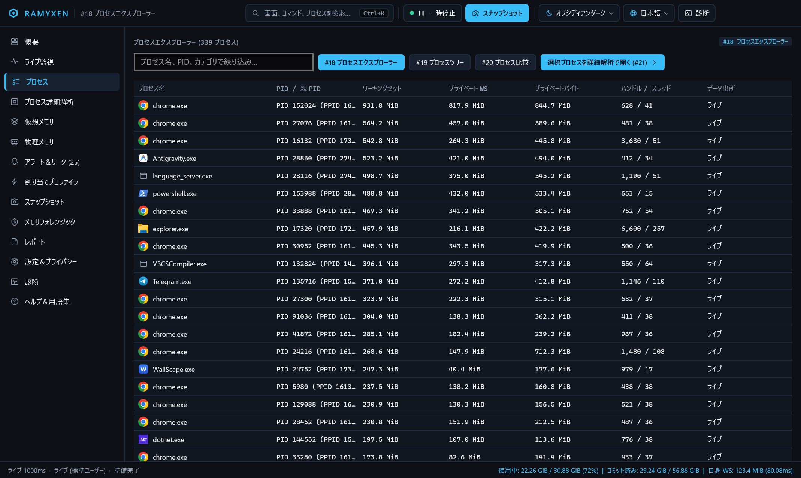
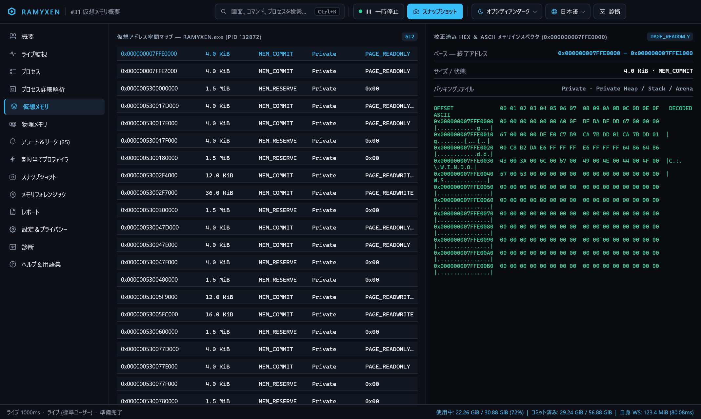
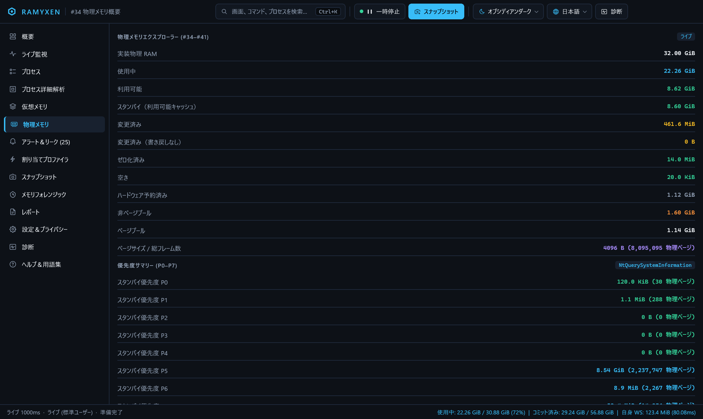
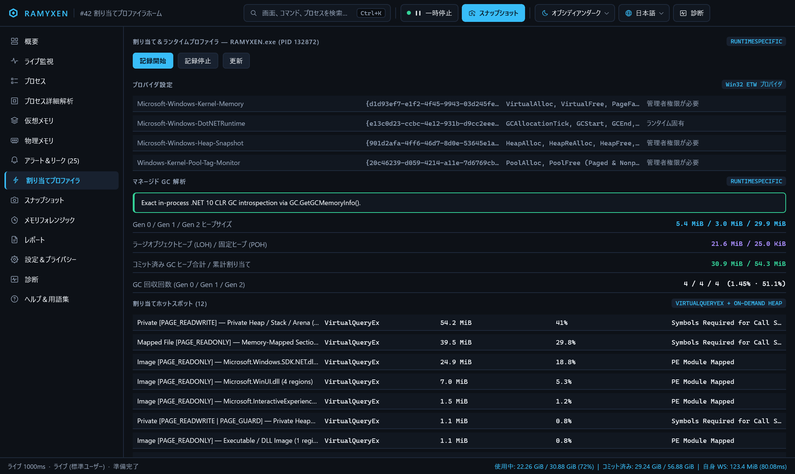
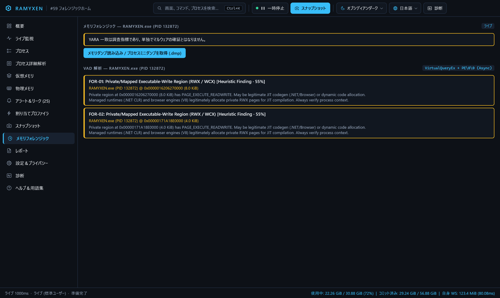
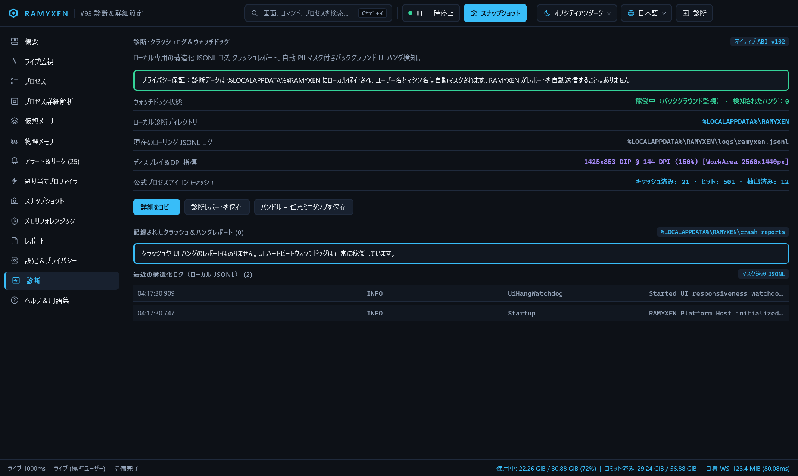
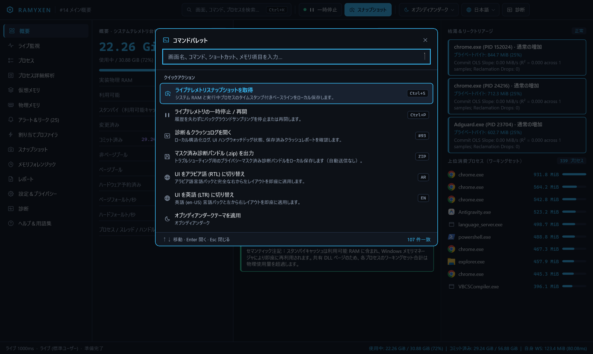

<div align="center">

**言語:** [English](README.md) · [العربية](README.ar.md) · [简体中文](README.zh-CN.md) · **日本語**


# RAMYXEN

### **すべてのバイトを理解する。**
**Windows ネイティブ メモリインテリジェンス・検査・解析・診断・フォレンジックプラットフォーム**

**対応環境:** Windows 11 (`x64`, Build 22000+) &nbsp;|&nbsp; **バージョン:** `v1.1.0` &nbsp;|&nbsp; **技術構成:** WinUI 3 · Windows App SDK 2.7 · .NET 10 LTS · C++20 ネイティブエンジン (ABI `v102`) + 分離プロセス `RAMYXEN.HeapWorker.exe` &nbsp;|&nbsp; **対応言語:** English · العربية (RTL) · 简体中文 · 日本語

[**リリースノート (v1.1.0)**](docs/release/v1.1.0/RELEASE_NOTES.md) &nbsp;·&nbsp; [**アーキテクチャ**](docs/architecture/ARCHITECTURE.md) &nbsp;·&nbsp; [**ユーザーガイド**](docs/user-guide/USER_GUIDE.md) &nbsp;·&nbsp; [**既知の制限**](docs/user-guide/KNOWN_LIMITATIONS.md) &nbsp;·&nbsp; [**コントリビュート**](CONTRIBUTING.md)

</div>

---

## 1. RAMYXEN とは？

一般的なシステムモニターは RAM 使用率のパーセンテージを表示するにとどまり、*なぜ*メモリが増加しているのか、物理メモリの高い使用率が再利用可能な Windows **スタンバイキャッシュ（Standby Cache）**なのか真のコミット圧迫なのか、あるいはメモリリークなのか通常のマネージド GC の挙動なのかを判別できません。

**RAMYXEN** はローカル完結型のネイティブ Windows デスクトップツールであり、**システム**・**プロセス**・**仮想アドレス空間**・**割り当て／ランタイムプロファイラ**・**物理ページリスト**・**メモリフォレンジック**の **6 つのメモリインテリジェンス層**を **Memory Atlas & Signal Observatory** 設計体系で統合します。

### RAMYXEN ではないもの
- **タスクマネージャーの代替ではありません** — エンジニア向けの高度なメモリ診断・解析ツールです。
- **メモリクリーナーや最適化ツールではありません** — ワーキングセットの強制解放や高速化を謳いません。
- **アンチウイルスソフトではありません** — フォレンジックや YARA 一致は調査指標であり、単独でマルウェアの確証とはなりません。
- **クラウドテレメトリゼロ** — ログ・スナップショット・レポート・任意のミニダンプはすべてローカルに保持されます。

---

## 2. 実際のアプリケーション画面（日本語 — `ja-JP`）

自己完結型 `RAMYXEN.exe`（WinUI 3、`1440×860` DIP、Windows 11 x64、ローカル `Yu Gothic UI` フォント）から直接取得した実機スクリーンショットです：

### メイン概要 (`#14`) ＆ プロセスエクスプローラー (`#18`)



### 仮想メモリ (`#31`)・物理メモリ (`#34`)・割り当てプロファイラ (`#42`)




### メモリフォレンジック (`#59`)・診断＆ウォッチドッグ (`#93`)・コマンドパレット (`Ctrl+K`)




---

## 3. 主な機能

1. **システムメモリインテリジェンス:** `GlobalMemoryStatusEx`・`GetPerformanceInfo`・`NtQuerySystemInformation` から物理 RAM、スタンバイキャッシュ (P0–P7)、変更済みページ、コミットチャージ／上限、カーネルプール、ページフォールト速度を直接取得します。
2. **プロセス解析＆分離ヒープ検査:** Windows 公式アプリアイコン (`PrivateExtractIconsW`)、UI をブロックしない非同期詳細解析、および独立子プロセス `RAMYXEN.HeapWorker.exe` による安全な NT ヒープ走査（`3.0s` タイムアウト、ABI `v102`、PID 再利用検証）。
3. **仮想＆物理メモリ探索:** 仮想アドレス空間マップ、保護属性、ライブ HEX/ASCII インスペクタ、9 種の `DataSourceProvenance` 出所バッジ。
4. **割り当てプロファイラ＆リークトリアージ:** OLS 線形回帰の傾きと $R^2$ による冷静なリーク判定、実 Win32 ETW セッション制御、`.NET` GC 世代解析（`Gen 0/1/2`、`LOH`、`POH`）。
5. **スナップショット・フォレンジック・マスク済みレポート:** SHA-256 検証付き JSON スナップショット比較、読み取り専用オフライン `.dmp` (`MDMP`) 解析、CSV（数式インジェクション対策）・JSON・HTML（XSS 対策）・PDF 1.4 出力と統一 PII/パスマスク。
6. **ローカル診断＆UI ハングウォッチドッグ:** ローリング JSONL ログ、電源遷移・デバッガ対応 `UiHangWatchdog`、明示的同意に基づく `diagnostic-dumps\` へのミニダンプ保存。

---

## 4. 動作環境・インストール・ポータブル版

- **対応 OS:** Windows 11 (`x64`, 21H2 / Build 22000 以降)。
- **インストーラー (`RAMYXEN-Setup.exe`):** 標準ユーザー向けインストール、サイレント実行 (`--silent`)、上書きアップグレード、NTFS ジャンクション保護、ロックファイル時の復旧可能なアンインストール（終了コード `1603` を正直に返し、再試行できるようアンインストール登録と実行ファイルを保持）に対応します。
- **自己完結型ポータブル版 (`RAMYXEN-Portable-win-x64.zip`):** `<SelfContained>true</SelfContained>`（`.NET 10.0.15` ランタイム同梱）と `<WindowsAppSDKSelfContained>true</WindowsAppSDKSelfContained>`（Windows App SDK `2.7.0` 同梱）の両方を有効化し、静的 CRT (`/MT`) のネイティブバイナリかつ PDB ゼロで構成されています。別途 .NET Desktop Runtime や Visual C++ 再頒布可能パッケージを導入せずに展開して `RAMYXEN.exe` を起動できます。

---

## 5. セキュリティ・権限・プラットフォーム境界

- 通常監視は標準ユーザー権限で動作します。Protected Process Light (PPL) プロセスは Windows により制限され (`ADMIN_REQUIRED`)、リアルタイム ETW セッションには管理者権限または *Performance Log Users* が必要です (`ETW_REQUIRED`)。
- 未署名カーネルドライバの導入や Secure Boot / HVCI の無効化は一切行いません。詳細は [KNOWN_LIMITATIONS.md](docs/user-guide/KNOWN_LIMITATIONS.md) および [SECURITY.md](SECURITY.md) をご覧ください。

---

## 6. 対応言語（公式 `4` ロケール）

| ロケール | 言語 | 方向 | 翻訳率 |
|---|---|---|---|
| `en-US` | English | LTR | `567 / 567` (`100.0%`) |
| `ar-SA` | العربية（アラビア語） | RTL (LRI+LRM 制御) | `567 / 567` (`100.0%`) |
| `zh-CN` | 简体中文（簡体字中国語） | LTR (`Microsoft YaHei UI`) | `567 / 567` (`100.0%`) |
| `ja-JP` | 日本語 | LTR (`Yu Gothic UI`) | `567 / 567` (`100.0%`) |

---

## 7. ビルド・テスト・コントリビュート（開発者向け）

### 必要環境
- Windows 11 (`x64`, Build 22000+)
- [.NET 10 SDK 10.0.404](https://dotnet.microsoft.com/en-us/download/dotnet/10.0)（`global.json` で `10.0.404` を固定指定）
- Visual Studio Build Tools（**C++ によるデスクトップ開発** と Windows 11 SDK `10.0.22621+`）
- Node.js 20+（ローカライズ検証スクリプト用）

### クリーン環境からのビルドと検証
```powershell
# 1. リリース一括ビルド（C++20 + 自己完結ポータブル ZIP + インストーラー + テスト）
.\scripts\build-release.ps1 -RunTests

# 2. 個別テストスイートの実行：
.\src\RAMYXEN.Native\bin\Release\RAMYXEN.Native.Tests.exe
dotnet tests\unit\RAMYXEN.Tests\bin\Release\net10.0-windows10.0.22621.0\win-x64\RAMYXEN.Tests.dll
node .\tools\localization\validate.js
node .\tests\localization\run-localization-tests.js
```

詳細は [CONTRIBUTING.md](CONTRIBUTING.md) および [BUILD_AND_DEPLOYMENT.md](docs/development/BUILD_AND_DEPLOYMENT.md) をご参照ください。

---

## 8. ライセンス状況

RAMYXEN のオリジナルソースコードおよびドキュメントは **Apache License 2.0** の下で提供されます。詳細はルートディレクトリの [LICENSE](LICENSE) をご参照ください。法的効力を持つ正式な条文は `LICENSE` の英文原文です。

サードパーティのランタイム、SDK、アイコン等のコンポーネントはそれぞれのライセンスおよび帰属表示に従います。詳細は [docs/security/THIRD_PARTY_NOTICES.md](docs/security/THIRD_PARTY_NOTICES.md) をご覧ください。
