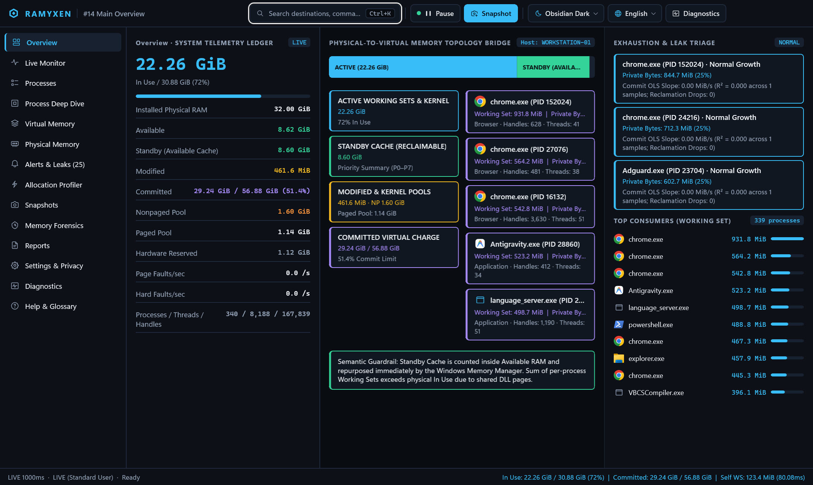
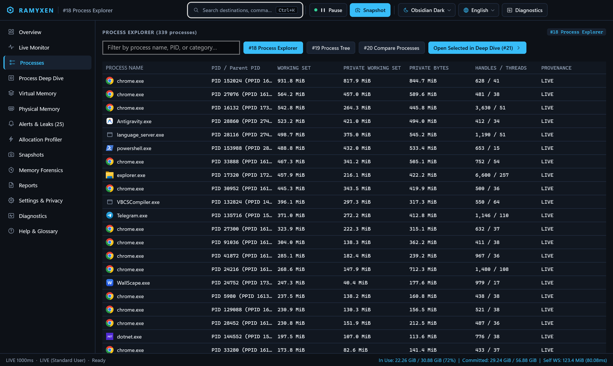
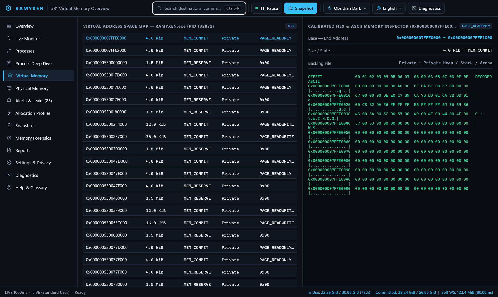
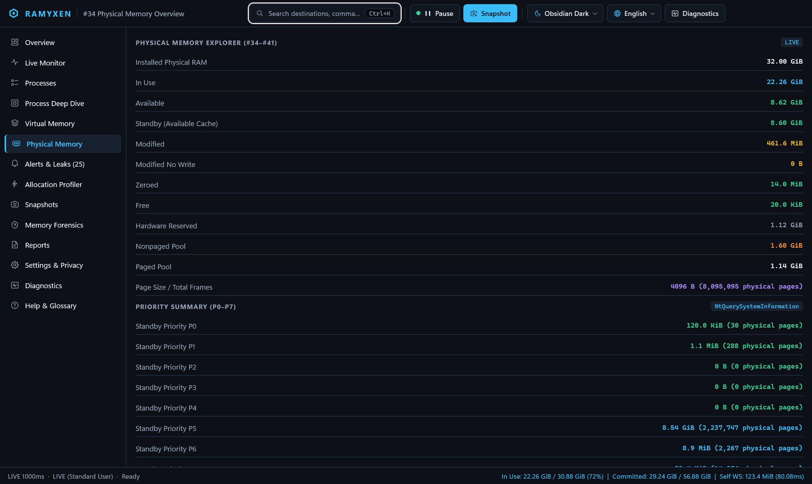
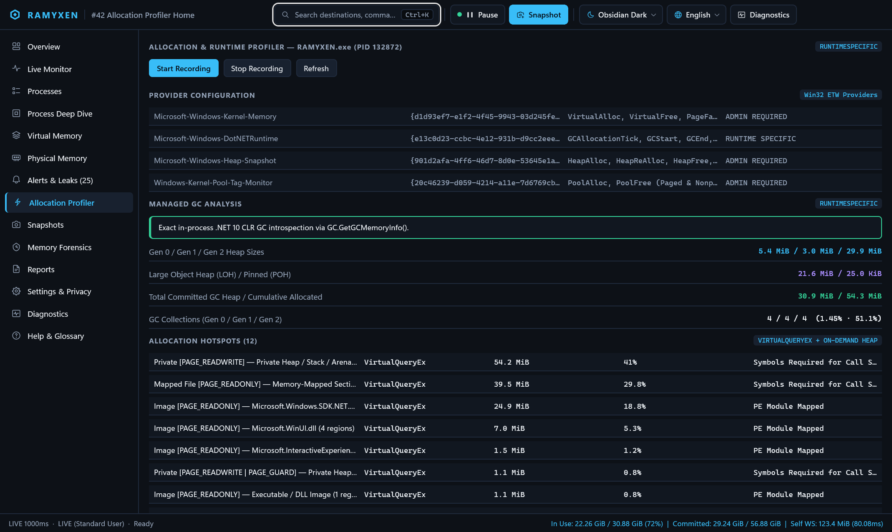
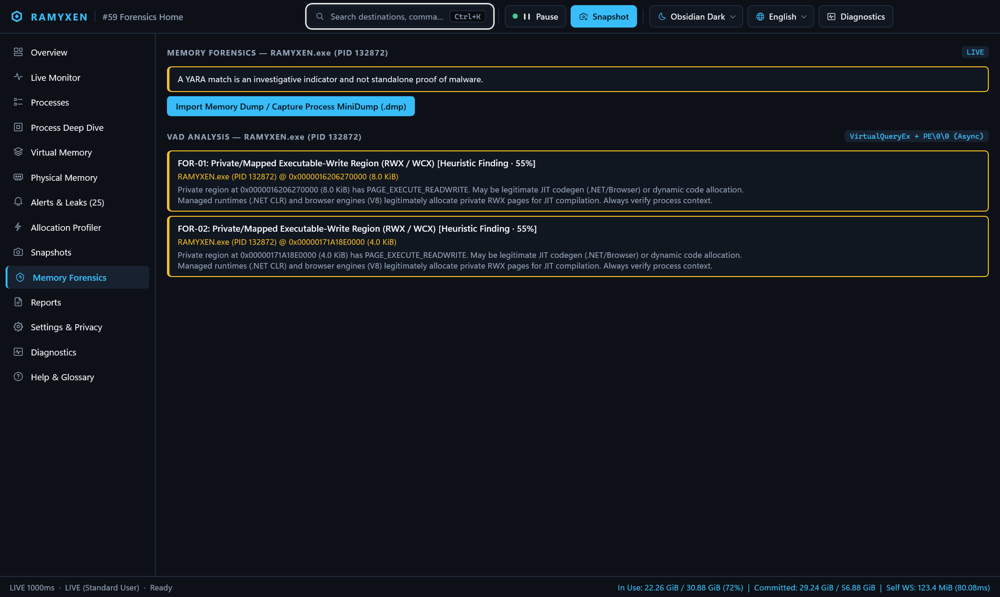
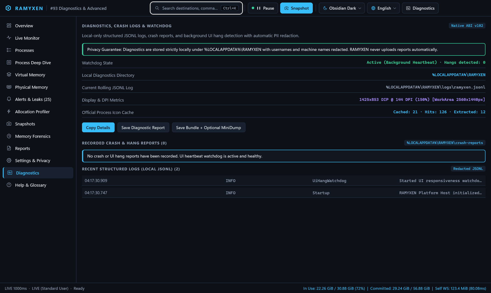
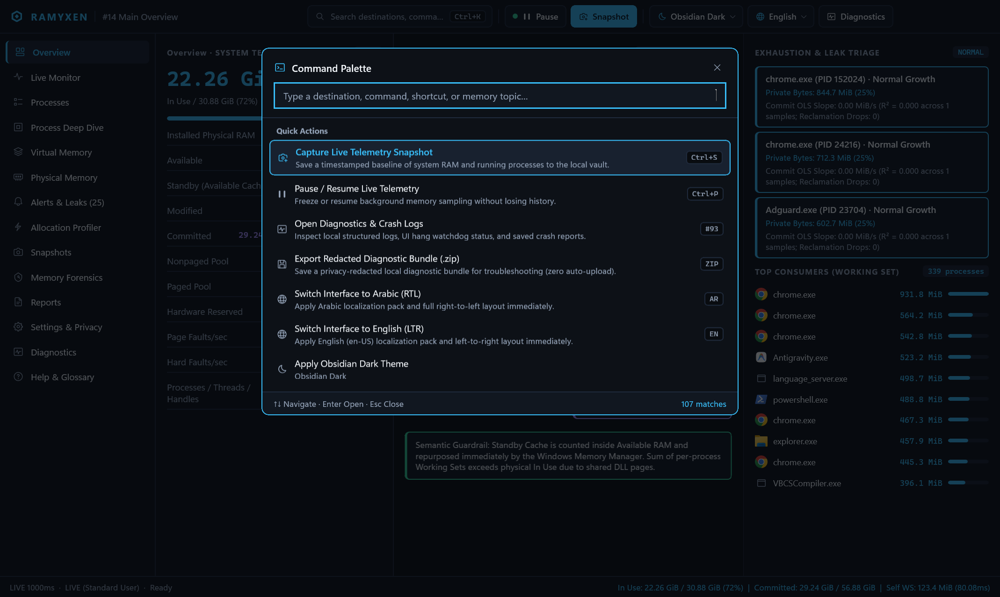

<div align="center">

**Languages:** **English** · [العربية](README.ar.md) · [简体中文](README.zh-CN.md) · [日本語](README.ja.md)


# RAMYXEN

### **Understand Every Byte.**
**Native Windows Memory Intelligence, Inspection, Analysis, Diagnostics & Forensics Platform**

**Platform:** Windows 11 (`x64`, Build 22000+) &nbsp;|&nbsp; **Version:** `v1.1.0` &nbsp;|&nbsp; **Stack:** WinUI 3 · Windows App SDK 2.7 · .NET 10 LTS · C++20 Native Engine (ABI `v102`) + Isolated `RAMYXEN.HeapWorker.exe` &nbsp;|&nbsp; **Locales:** English · العربية (RTL) · 简体中文 · 日本語

[**Release Notes (v1.1.0)**](docs/release/v1.1.0/RELEASE_NOTES.md) &nbsp;·&nbsp; [**Architecture**](docs/architecture/ARCHITECTURE.md) &nbsp;·&nbsp; [**User Guide**](docs/user-guide/USER_GUIDE.md) &nbsp;·&nbsp; [**Known Limitations**](docs/user-guide/KNOWN_LIMITATIONS.md) &nbsp;·&nbsp; [**Contributing**](CONTRIBUTING.md)

</div>

---

## 1. What Is RAMYXEN?

Ordinary system monitors stop at a flat RAM percentage. They cannot explain *why* memory is growing, whether high physical utilization is merely reclaimable Windows Standby Cache or genuine commit pressure, or whether a growing process reflects a real memory leak versus normal managed garbage collection.

**RAMYXEN** is a local-only, native Windows desktop instrument uniting **six memory intelligence layers**—**System**, **Process**, **Virtual Address Space**, **Allocation & Runtime Profiling**, **Physical Page Lists**, and **Memory Forensics**—under the **Memory Atlas & Signal Observatory** design system.

### What RAMYXEN Is NOT
- **Not a Task Manager replacement** — RAMYXEN is a deep memory diagnostics and engineering analysis instrument.
- **Not a RAM cleaner or optimizer** — RAMYXEN never flushes working sets or claims to "boost" RAM.
- **Not antivirus software** — Forensics and YARA indicators are investigative signals, never standalone malware verdicts.
- **Zero cloud telemetry** — All logs, snapshots, reports, and optional consent-gated dumps remain strictly on your machine.

---

## 2. Live Application Screenshots (English — `en-US`)

Captured directly from the live self-contained `RAMYXEN.exe` WinUI 3 application (`1440×860` DIP, Windows 11 x64):

### Main Architectural Overview (`#14`) & Process Explorer (`#18`)



### Virtual Memory (`#31`), Physical Memory (`#34`) & Allocation Profiler (`#42`)




### Memory Forensics (`#59`), Diagnostics & Watchdog (`#93`) & Command Palette (`Ctrl+K`)




---

## 3. Core Capabilities

1. **System Memory Intelligence:** Real-time physical RAM, Standby Cache (P0–P7), Modified pages, Commit Charge vs. Limit, Nonpaged/Paged Kernel Pools, and Page/Hard Fault velocity directly from `GlobalMemoryStatusEx`, `GetPerformanceInfo`, and `NtQuerySystemInformation`.
2. **Process Memory & Isolated Heap Inspection:** Official Windows executable icons (`PrivateExtractIconsW`), non-blocking async deep dive (virtual regions, Toolhelp32 modules with file versions, threads, handles, consent-gated strings), and killable out-of-process `RAMYXEN.HeapWorker.exe` (`3.0s` timeout, ABI `v102`, PID-reuse protection).
3. **Virtual & Physical Memory Exploration:** Address-space mapping, protection flags, live hex/ASCII byte inspection, and honest provenance boundaries across all 9 `DataSourceProvenance` classifications.
4. **Allocation Profiler & Leak Triage:** OLS linear regression slope + $R^2$ leak investigation with warm-up guardrails, real Win32 ETW session management (`StartTraceW`/`ControlTraceW`), and `.NET` GC generation introspection (`Gen 0/1/2`, `LOH`, `POH`).
5. **Snapshots, Forensics & Redacted Reporting:** SHA-256-verified JSON snapshots with differential comparison, read-only offline `.dmp` (`MDMP`) inspection, CSV (CWE-1236 safe), JSON, HTML (XSS-safe), and PDF 1.4 exports with unified PII/path redaction.
6. **Local Diagnostics & UI Hang Watchdog:** Rolling JSONL logs, power-/debugger-aware `UiHangWatchdog`, consent-gated off-thread `MiniDumpNormal` in isolated `diagnostic-dumps\`, and redacted ZIP bundle export.

---

## 4. System Requirements, Installation & Portable Usage

- **Operating System:** Windows 11 (`x64`, Version 21H2 / Build 22000 or later).
- **Installer (`RAMYXEN-Setup.exe`):** Standard-User per-user installer supporting silent mode (`--silent`), in-place upgrades, verified shortcut/registry cleanup, NTFS junction safety, and recoverable locked-file uninstall (`ExitCode 1603` preserves uninstall registration for retry).
- **Self-Contained Portable (`RAMYXEN-Portable-win-x64.zip`):** Built with **both** `<SelfContained>true</SelfContained>` (`.NET 10.0.15` runtime bundled) and `<WindowsAppSDKSelfContained>true</WindowsAppSDKSelfContained>` (Windows App SDK `2.7.0` bundled), with static-CRT (`/MT`) native components and zero PDBs. Extract and run `RAMYXEN.exe` directly without installing a separate .NET Desktop Runtime or Visual C++ Redistributable.

---

## 5. Security, Permissions & Platform Boundaries

- **Standard User vs. Administrator:** Routine monitoring runs as a Standard User. Inspecting Protected Process Light (PPL) targets is restricted by Windows (`ADMIN_REQUIRED`); starting real-time ETW sessions requires Administrator or *Performance Log Users* membership (`ETW_REQUIRED`).
- **No Unsigned Kernel Drivers:** RAMYXEN never installs unsigned Ring-0 drivers or weakens Secure Boot / HVCI. Hardware PFN database walks require a signed kernel driver (`DRIVER_REQUIRED`).
- See [KNOWN_LIMITATIONS.md](docs/user-guide/KNOWN_LIMITATIONS.md) and [SECURITY.md](SECURITY.md) for full details.

---

## 6. Supported Application Languages (`4` Official Locales)

| Locale | Language | Direction | Completeness |
|---|---|---|---|
| `en-US` | English | LTR | `567 / 567` (`100.0%`) |
| `ar-SA` | العربية (Arabic) | RTL (LRI+LRM Bidi isolation) | `567 / 567` (`100.0%`) |
| `zh-CN` | 简体中文 (Simplified Chinese) | LTR (`Microsoft YaHei UI`) | `567 / 567` (`100.0%`) |
| `ja-JP` | 日本語 (Japanese) | LTR (`Yu Gothic UI`) | `567 / 567` (`100.0%`) |

External UTF-8 JSON packs live in `localization/locales/` and can be reloaded at runtime without recompiling.

---

## 7. Building, Testing & Contributing (Clean-Clone Developer Guide)

### Prerequisites
- Windows 11 (`x64`, Build 22000+)
- [.NET 10 SDK 10.0.404](https://dotnet.microsoft.com/en-us/download/dotnet/10.0) (pinned in `global.json` with `latestPatch` roll-forward and `allowPrerelease: false`)
- Visual Studio 2022/2026 Build Tools with **Desktop development with C++** (MSVC v143+ and Windows 11 SDK `10.0.22621+`)
- Node.js 20+ (for localization validation scripts)

### Build & Verify from a Clean Clone
```powershell
# 1. Full reproducible Release build (Native C++20 + Self-Contained Portable ZIP + Installer + Tests)
.\scripts\build-release.ps1 -RunTests

# 2. Or run individual verification suites:
.\src\RAMYXEN.Native\bin\Release\RAMYXEN.Native.Tests.exe
dotnet tests\unit\RAMYXEN.Tests\bin\Release\net10.0-windows10.0.22621.0\win-x64\RAMYXEN.Tests.dll
node .\tools\localization\validate.js
node .\tests\localization\run-localization-tests.js
```

### Troubleshooting
- **Missing MSVC `cl.exe`:** Ensure Visual Studio Build Tools with C++ x64/x86 build tools are installed; `src\RAMYXEN.Native\build_native.cmd` auto-locates `vcvars64.bat` via `vswhere.exe`.
- **Installer build fails with `PayloadZipPath` missing:** Build the Portable ZIP first or run `.\scripts\build-release.ps1`.
- See [CONTRIBUTING.md](CONTRIBUTING.md) and [BUILD_AND_DEPLOYMENT.md](docs/development/BUILD_AND_DEPLOYMENT.md) for contribution workflow and packaging details.

---

## 8. License & Third-Party Notices

RAMYXEN's original source code and documentation are licensed under the **Apache License, Version 2.0** — see [LICENSE](LICENSE). The authoritative legal text is the English text in `LICENSE`.

Third-party runtime, SDK, and icon components remain subject to their respective licenses and attribution notices as documented in [docs/security/THIRD_PARTY_NOTICES.md](docs/security/THIRD_PARTY_NOTICES.md).
