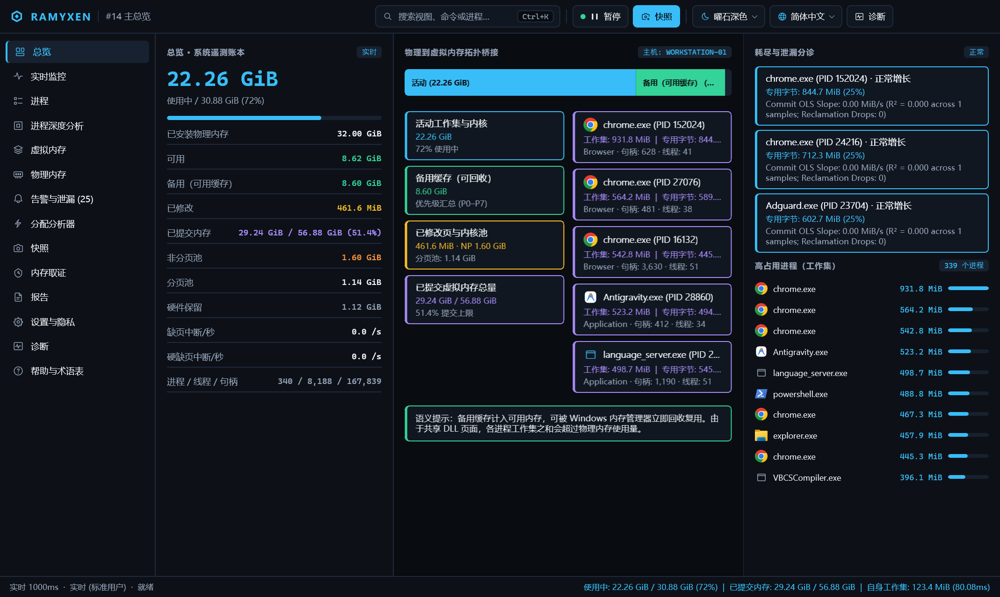
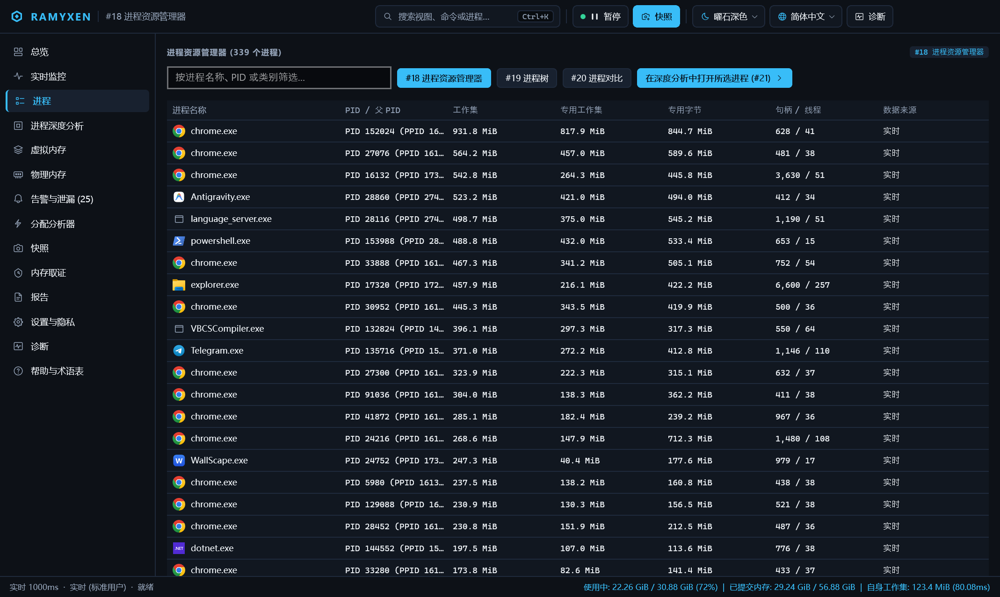
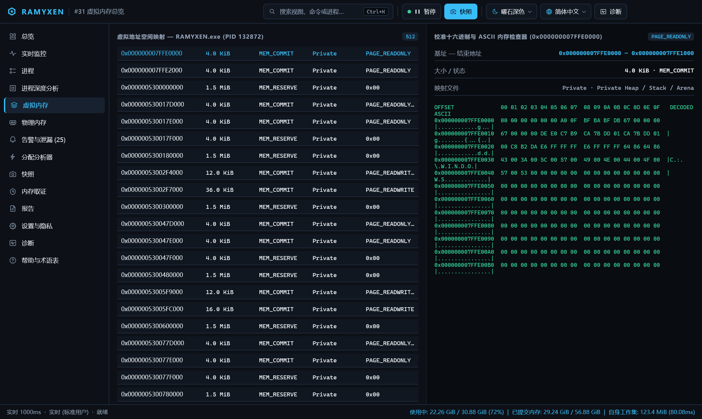
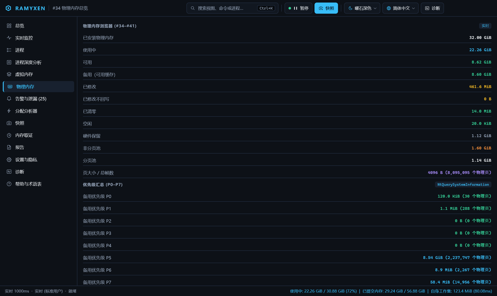
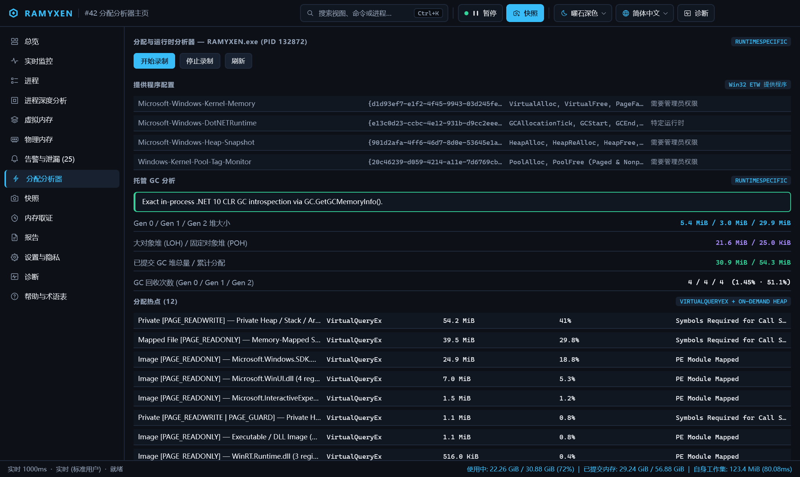
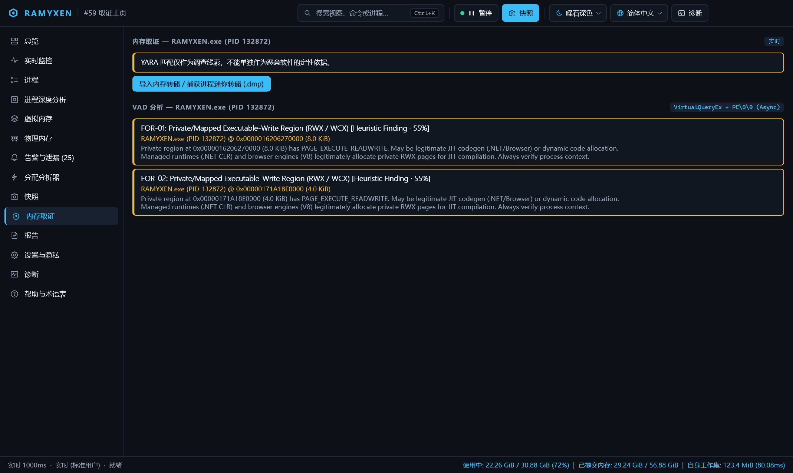
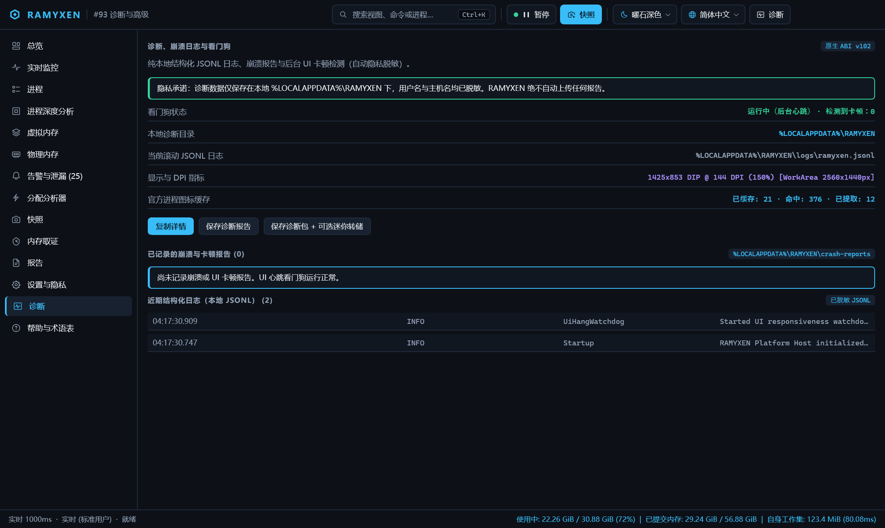
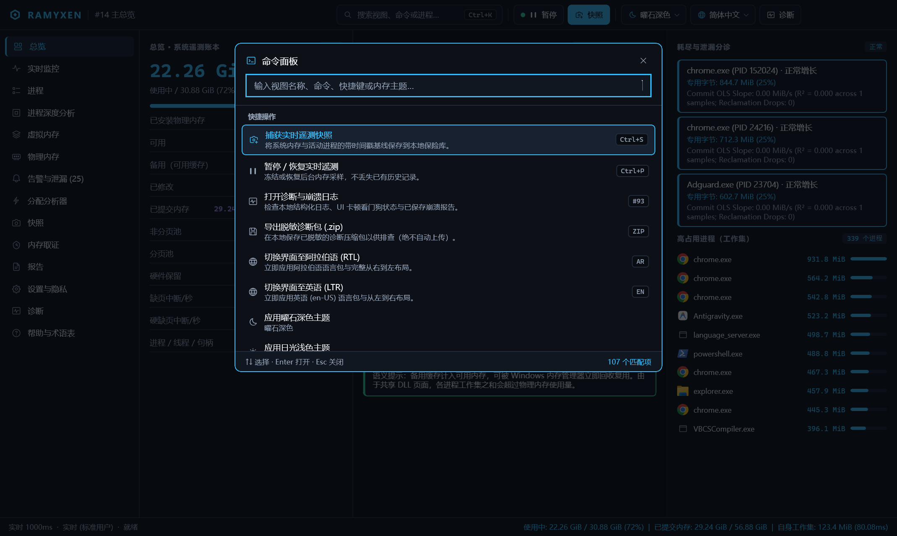

<div align="center">

**语言：** [English](README.md) · [العربية](README.ar.md) · **简体中文** · [日本語](README.ja.md)


# RAMYXEN

### **洞察每一字节。**
**Windows 原生内存智能、检查、分析、诊断与取证平台**

**支持平台：** Windows 11 (`x64`，Build 22000+) &nbsp;|&nbsp; **版本：** `v1.1.0` &nbsp;|&nbsp; **技术栈：** WinUI 3 · Windows App SDK 2.7 · .NET 10 LTS · C++20 原生引擎 (ABI `v102`) + 隔离进程 `RAMYXEN.HeapWorker.exe` &nbsp;|&nbsp; **界面语言：** English · العربية (RTL) · 简体中文 · 日本語

[**发布说明 (v1.1.0)**](docs/release/v1.1.0/RELEASE_NOTES.md) &nbsp;·&nbsp; [**系统架构**](docs/architecture/ARCHITECTURE.md) &nbsp;·&nbsp; [**用户指南**](docs/user-guide/USER_GUIDE.md) &nbsp;·&nbsp; [**已知限制**](docs/user-guide/KNOWN_LIMITATIONS.md) &nbsp;·&nbsp; [**参与贡献**](CONTRIBUTING.md)

</div>

---

## 1. 什么是 RAMYXEN？

常规系统监控工具只提供笼统的内存占用百分比，无法回答内存*为何*增长、物理内存高占用究竟是可即时回收的 Windows **备用缓存（Standby Cache）**还是真正的提交压力，也无法区分真实的内存泄漏与托管运行时正常的垃圾回收波动。

**RAMYXEN** 是一款纯本地运行的原生 Windows 桌面工程工具，将**六大内存智能分析层**——**系统**、**进程**、**虚拟地址空间**、**分配与运行时分析**、**物理页列表**与**内存取证**——整合在 **Memory Atlas & Signal Observatory** 视觉体系之下。

### RAMYXEN 不是什么
- **不是任务管理器替代品** —— 而是面向工程师与分析师的深度内存诊断仪表。
- **不是内存清理/加速软件** —— 绝不强行清空工作集或宣称“优化加速内存”。
- **不是杀毒软件** —— 取证与 YARA 匹配仅作为调查线索，不作为恶意软件的独立定性依据。
- **零云端遥测** —— 所有日志、快照、报告与可选迷你转储均严格保存在本机。

---

## 2. 实际运行截图（简体中文 — `zh-CN`）

以下截图直接采集自独立打包运行的 `RAMYXEN.exe` WinUI 3 应用（`1440×860` DIP，Windows 11 x64，本地 `Microsoft YaHei UI` 渲染）：

### 主总览 (`#14`) 与进程资源管理器 (`#18`)



### 虚拟内存 (`#31`)、物理内存 (`#34`) 与分配分析器 (`#42`)




### 内存取证 (`#59`)、诊断与看门狗 (`#93`) 与命令面板 (`Ctrl+K`)




---

## 3. 核心功能

1. **系统内存智能：** 直接通过 `GlobalMemoryStatusEx`、`GetPerformanceInfo` 和 `NtQuerySystemInformation` 采集物理内存、备用缓存 (P0–P7)、已修改页、已提交内存与上限、分页/非分页内核池及缺页中断速率。
2. **进程内存与隔离堆检查：** 提取 Windows 官方应用图标 (`PrivateExtractIconsW`)，非阻塞异步深度分析（虚拟区域、Toolhelp32 模块与版本、线程、句柄、需明确许可的字符串扫描），并通过可终止子进程 `RAMYXEN.HeapWorker.exe` 执行原生 NT 堆遍历（`3.0s` 预算、ABI `v102`、PID 复用校验）。
3. **虚拟与物理内存浏览：** 虚拟地址空间映射、页保护标志、实时 Hex/ASCII 检查器与完整的 9 类 `DataSourceProvenance` 来源标注。
4. **分配分析与泄漏分诊：** 基于 OLS 线性回归斜率与 $R^2$ 的非恐慌式泄漏分诊、真实 Win32 ETW 会话控制，以及 `.NET` GC 代际统计（`Gen 0/1/2`、`LOH`、`POH`）。
5. **快照、取证与隐私脱敏报告：** 带 SHA-256 校验的本地 JSON 快照及差异对比、只读离线 `.dmp` (`MDMP`) 解析，支持 CSV（防公式注入）、JSON、HTML（防 XSS）与 PDF 1.4 统一脱敏导出。
6. **本地诊断与 UI 卡顿看门狗：** 滚动 JSONL 日志、感知系统休眠与调试器的 `UiHangWatchdog`，以及保存在独立 `diagnostic-dumps\` 中的许可制迷你转储。

---

## 4. 系统要求、安装与便携版说明

- **操作系统：** Windows 11 (`x64`，21H2 / Build 22000 或更高版本)。
- **安装程序 (`RAMYXEN-Setup.exe`)：** 支持标准用户安装、静默安装 (`--silent`)、原地升级、NTFS 联接安全保护，以及文件被占用时的可恢复卸载（返回诚实的退出码 `1603` 并保留卸载注册项与卸载程序，关闭占用进程后重试即可干净卸载）。
- **独立便携版 (`RAMYXEN-Portable-win-x64.zip`)：** 同时启用 `<SelfContained>true</SelfContained>`（内置 `.NET 10.0.15` 运行时）与 `<WindowsAppSDKSelfContained>true</WindowsAppSDKSelfContained>`（内置 Windows App SDK `2.7.0`），配合静态链接 CRT (`/MT`) 的原生组件且不含 PDB，解压后可直接运行 `RAMYXEN.exe`，无需额外安装 .NET Desktop Runtime 或 Visual C++ 运行库。

---

## 5. 安全、权限与平台边界

- 常规监控在标准用户下运行；受保护进程（PPL）受 Windows 内核限制 (`ADMIN_REQUIRED`)；实时 ETW 跟踪需要管理员权限或 *Performance Log Users* 成员资格 (`ETW_REQUIRED`)。
- RAMYXEN 绝不安装未签名内核驱动，也不会削弱 Secure Boot / HVCI。详见 [KNOWN_LIMITATIONS.md](docs/user-guide/KNOWN_LIMITATIONS.md) 与 [SECURITY.md](SECURITY.md)。

---

## 6. 支持的应用语言（`4` 种官方语言）

| 语言代码 | 语言 | 书写方向 | 完整度 |
|---|---|---|---|
| `en-US` | English | LTR | `567 / 567` (`100.0%`) |
| `ar-SA` | العربية（阿拉伯语） | RTL (LRI+LRM 双向隔离) | `567 / 567` (`100.0%`) |
| `zh-CN` | 简体中文 | LTR (`Microsoft YaHei UI`) | `567 / 567` (`100.0%`) |
| `ja-JP` | 日本語（日语） | LTR (`Yu Gothic UI`) | `567 / 567` (`100.0%`) |

---

## 7. 构建、测试与贡献（开发者指南）

### 环境要求
- Windows 11 (`x64`，Build 22000+)
- [.NET 10 SDK 10.0.404](https://dotnet.microsoft.com/en-us/download/dotnet/10.0)（`global.json` 固定 `10.0.404`）
- Visual Studio Build Tools（含 **使用 C++ 的桌面开发** 与 Windows 11 SDK `10.0.22621+`）
- Node.js 20+（用于本地化校验脚本）

### 从干净克隆构建与验证
```powershell
# 1. 一键复现 Release 构建（原生 C++20 + 独立便携版 ZIP + 安装程序 + 测试）
.\scripts\build-release.ps1 -RunTests

# 2. 或分别运行各项自动化验证：
.\src\RAMYXEN.Native\bin\Release\RAMYXEN.Native.Tests.exe
dotnet tests\unit\RAMYXEN.Tests\bin\Release\net10.0-windows10.0.22621.0\win-x64\RAMYXEN.Tests.dll
node .\tools\localization\validate.js
node .\tests\localization\run-localization-tests.js
```

详见 [CONTRIBUTING.md](CONTRIBUTING.md) 与 [BUILD_AND_DEPLOYMENT.md](docs/development/BUILD_AND_DEPLOYMENT.md)。

---

## 8. 许可证状态

RAMYXEN 的原创源代码与文档采用 **Apache License 2.0** 许可协议发布，详见根目录 [LICENSE](LICENSE)。具有法律效力的权威文本为 `LICENSE` 中的英文原文。

第三方运行时、SDK 及图标组件仍受各自原有许可证与归属声明约束，详见 [docs/security/THIRD_PARTY_NOTICES.md](docs/security/THIRD_PARTY_NOTICES.md)。
