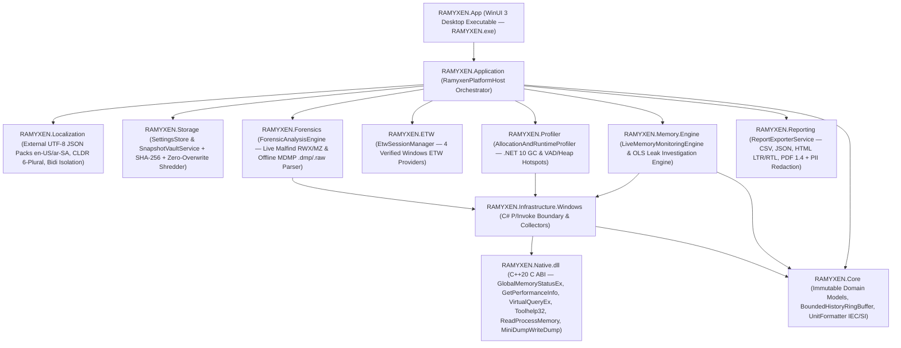

# RAMYXEN — Platform & Engineering Architecture

**Version:** `1.1.0`  
**Target Runtime:** `.NET 10 LTS` (`net10.0-windows10.0.22621.0`) + `WinUI 3` (`Microsoft.WindowsAppSDK 2.7.0`) + Native C++20 Engine (`RAMYXEN.Native.dll`)

---

## 1. Layered Production Architecture

---

## 2. Six Memory Intelligence Layers

RAMYXEN organizes Windows memory analysis into six layered domains with explicit `DataSourceProvenance` (`EXACT`, `PARTIAL`, `ESTIMATED`, `RUNTIME_SPECIFIC`, `ACCESS_DENIED`, `ELEVATION_REQUIRED`, `UNAVAILABLE`):

1. **System Memory Intelligence (`RAMYXEN.Native.dll` + `WindowsSystemMemoryCollector`):** Global physical/virtual counters (`GlobalMemoryStatusEx`, `GetPerformanceInfo`), Standby vs. Modified vs. Active lists, Commit Charge/Limit/Peak, Kernel Paged/Nonpaged Pools, Page/Hard Fault rates.
2. **Process Memory Intelligence (`WindowsProcessCollector`):** Working Set, Private Working Set, Shared Working Set, Private Commit, Peak Working Set, Virtual Size, Handles, Modules (`MODULEENTRY32W`), Threads (`THREADENTRY32`), Parent-Child Ancestry Tree (`PROCESSENTRY32W`).
3. **Virtual Memory Intelligence (`Ramyxen_EnumerateVirtualRegions` + `Ramyxen_ReadProcessMemorySafe`):** 64-bit User VAS regions via `VirtualQueryEx`, state (`MEM_COMMIT`, `MEM_RESERVE`, `MEM_FREE`), type (`MEM_IMAGE`, `MEM_MAPPED`, `MEM_PRIVATE`), protection flags, native heaps (`GetProcessHeaps` / `Heap32ListFirst`), Consent-Gated Live ASCII/UTF-16 String Search, and Live Hex/ASCII Inspector.
4. **Allocation & Runtime Intelligence (`EtwSessionManager` + `AllocationAndRuntimeProfiler`):** 4 verified Windows ETW providers (`Kernel-Memory`, `DotNETRuntime`, `Kernel-Process`, `Heap-Snapshot`), live `.NET 10` CLR GC generation/fragmentation introspection (`GC.GetGCMemoryInfo()`), and virtual region/heap hotspot attribution.
5. **Memory Exhaustion & Leak Investigation Engine (`MemoryExhaustionAndLeakEngine`):** Ordinary Least-Squares (OLS) linear regression ($\text{Bytes/s}$ growth slope + $R^2$), non-alarmist warm-up and bounded-cache guardrails, 9 exhaustion classifications, and 6 leak evidence tiers (`NormalGrowth` through `ConfirmedLeak`).
6. **Snapshots, Forensics & Multi-Format Reporting (`SnapshotVaultService`, `ForensicAnalysisEngine`, `ReportExporterService`):** Real Windows process MiniDumps (`MiniDumpWriteDump` via `dbghelp.dll`), SHA-256 snapshot vault with differential comparison and 64 KiB zero-overwrite shredding, live Malfind private `PAGE_EXECUTE_READWRITE` / `MZ` header detection, offline `MDMP` `.dmp` / `.raw` binary parsing, and CSV/JSON/HTML/PDF 1.4 export with PII path redaction.

---

## 3. Foundational Internationalization & Full Arabic RTL Layer

Internationalization is a first-class architectural service (`RAMYXEN.Localization`) independent of UI and telemetry logic:
- **External UTF-8 JSON Packs:** `localization/locales/en-US.json` (LTR) and `localization/locales/ar-SA.json` (RTL), plus `%LOCALAPPDATA%\RAMYXEN\localization\locales\` user overrides.
- **6-Category Arabic CLDR ICU Pluralization:** Full support for `zero`, `one`, `two`, `few`, `many`, and `other`.
- **Unicode Bidi Isolation:** Wraps technical tokens (hex addresses, PIDs, file paths) in `\u2066...\u2069` so they never invert inside Arabic RTL sentences.
- **Instant Runtime Switching:** Switches languages (`en-US` ↔ `ar-SA`) and themes (`Dark` / `Light` / `HighContrast`) live at runtime without restarting `RAMYXEN.exe`.
