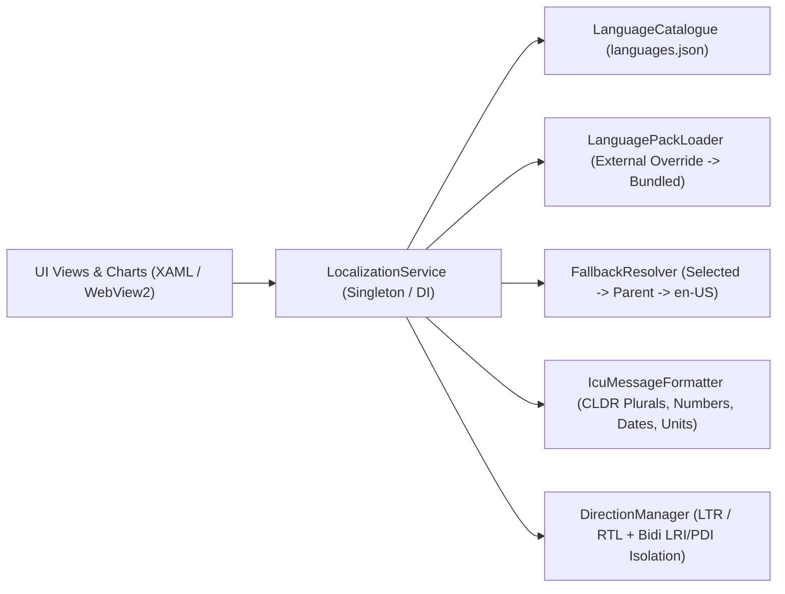

# RAMYXEN — Internationalization & Localization Architecture

**Phase:** 2.0 Foundation Specification  
**Reference Locales:** `en-US` (Canonical, LTR) · `ar-SA` (Arabic, RTL)

---

## 1. Architectural Principles

1. **Single Canonical Source of Truth:** All user-facing strings live exclusively in UTF-8 JSON packs under `localization/locales/<bcp47>.json`. We explicitly forbid splitting UI text between compiled XAML `.resw` files and runtime JSON files.
2. **Zero Code Changes to Edit or Add Languages:** Editing `ar-SA.json` or adding `fr-FR.json` + registering it in `languages.json` requires zero changes to UI source code.
3. **Runtime Switching Without Restart:** Changing language triggers an atomic resource swap in `LocalizationService` and publishes a `LanguageChanged` event marshaled onto the UI Dispatcher thread, updating all bound views and `FlowDirection` immediately.
4. **Untrusted Data Safety:** External JSON packs are strictly parsed as data (UTF-8 JSON only, max `5 MB`, schema-validated, zero script/code evaluation). Malformed packs are safely rejected with fallback to `en-US`.

---

## 2. Core Service Components

### Runtime Loading Priority & Windows Deployment Model
To ensure maintainers can edit or drop in language packs without recompiling—even if packaged with MSIX where the install directory is read-only—`LanguagePackLoader` resolves packs in deterministic priority order:
1. **User External Override Directory (Writable at Runtime):** `%LOCALAPPDATA%\RAMYXEN\localization\locales\<locale>.json` (and `languages.json`).
2. **Machine-Wide Shared Override Directory:** `%ProgramData%\RAMYXEN\localization\locales\<locale>.json`.
3. **Bundled Application Fallback Directory (Read-Only):** `<AppInstallDir>\localization\locales\<locale>.json`.

*Limitation Documented Transparently:* If RAMYXEN is deployed as a signed MSIX package, files inside `<AppInstallDir>` are immutable by Windows OS design; therefore, runtime user edits and newly added community packs are placed in `%LOCALAPPDATA%\RAMYXEN\localization\` and loaded automatically on startup or via **Settings → Reload Language Packs** without rebuilding.

---

## 3. Fallback Resolution & Thread Safety

- **Fallback Hierarchy:** `1. Selected Locale (e.g. ar-EG)` → `2. Configured Parent Locale (e.g. ar-SA)` → `3. Canonical Source (en-US)` → `4. Diagnostic Key Marker ([missing:key])` (never crashes the app).
- **Thread Safety & Dispatcher:** `LocalizationService` stores the active locale bundle in an immutable snapshot object swapped via atomic reference exchange. `LanguageChanged` notifications are dispatched asynchronously to the UI thread (`DispatcherQueue.TryEnqueue` in WinUI 3 or reactive store update in WebView2).
- **WinUI 3 Integration Note:** In Phase 2.1, a custom XAML markup extension (`{loc:Text Key=navigation.overview}`) binds to `LocalizationService` via `INotifyPropertyChanged`, eliminating dual `.resw` drift while supporting instant runtime language switching.

---

## 4. Arabic RTL & Bidirectional Text Isolation

- **Layout Mirroring (`FlowDirection`):** Switching to an `rtl` locale flips the main window `FlowDirection` to `RightToLeft`, mirroring the left navigation rail to the right, reversing dialog button order, aligning tables right-to-left, and mirroring directional navigation icons (back/forward arrows, tree expanders).
- **Strict LTR Isolation for Technical Tokens:** Memory addresses (`0x00007FF6A0000000`), hex dumps, PIDs (`19240`), PFNs (`0x001A4F20`), GUIDs, Windows file paths (`C:\Windows\System32\ntdll.dll`), process names, stack traces, and IP addresses MUST be wrapped in Unicode Bidirectional Isolates (`\u2066` LRI … `\u2069` PDI) or explicit `FlowDirection="LeftToRight"` / `dir="ltr"` containers.
- **Non-Mirrored Analytical Visualizations:** Chronological time-series charts (Live Signal Observatory, Allocation Timeline) and radial/polar gauges MUST remain left-to-right chronological even in RTL mode; only their surrounding legends, headers, and inspector panels adapt to RTL.
- **Arabic Typography:** Primary UI stack uses `Segoe UI Variable` with `Tahoma` / `Noto Sans Arabic` fallback; technical values remain `Cascadia Code` (LTR). Western digits (`0–9`) are preserved for memory addresses, hex, and technical telemetry to avoid ambiguity in diagnostics.

---

## 5. ICU MessageFormat Pluralization & Memory Units

- **No String Concatenation:** Dynamic messages use **ICU MessageFormat** (`{count, plural, zero {...} one {...} two {...} few {...} many {...} other {...}}`). Arabic uses all **6 CLDR plural categories** (`zero`, `one`, `two`, `few`, `many`, `other`).
- **Binary vs. Decimal Memory Units:** IEC binary units (`B`, `KiB`, `MiB`, `GiB`, `TiB`) and SI decimal units (`KB`, `MB`, `GB`, `TB`) are strictly distinguished per data source and formatted via the active culture's decimal/grouping separators.
